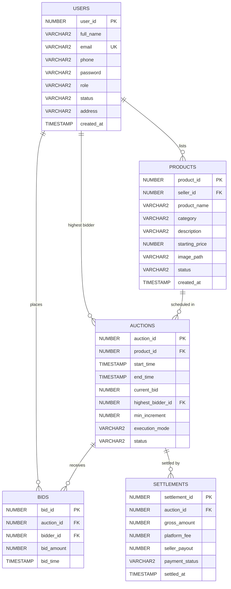

# HASHbid
### A Real-Time Online Auction Marketplace

[](https://www.oracle.com/java/)
[](https://jakarta.ee/)
[](https://jakarta.ee/specifications/servlet/6.0/)
[](https://www.oracle.com/database/)
[](https://tomcat.apache.org/)

HASHbid is an electronic auction marketplace engineered with Jakarta EE 10, Java 21, and Oracle Database XE. The platform bridges the gap between verified merchants and eager bidders by providing a structured, secure, and transparent bidding environment. Merchants submit curated catalog items for administrative appraisal, registered buyers place competitive offers with sub-second feedback, and an automated background daemon continuously supervises auction lifecycles and determines winning outcomes upon hammer fall.

The user interface features a custom brand identity (**Ink Black `#11151C`**, **Graphite `#202834`**, **Muted Bronze `#B58D5A`**, **Warm Ivory `#E8E5DE`**, **Slate Grey `#8993A1`**, and **Muted Green `#567C68`**) with Georgia serif headings, Inter body typography, and monospace tabular pricing.

---

## Table of Contents
1. [Project Preview & Screenshots](#1-project-preview--screenshots)
2. [Core Features & Role Matrix](#2-core-features--role-matrix)
3. [Technology Stack](#3-technology-stack)
4. [Architecture & Request Flow](#4-architecture--request-flow)
5. [Database Structure & Schema](#5-database-structure--schema)
6. [Prerequisites](#6-prerequisites)
7. [Installation & Setup Guide](#7-installation--setup-guide)
8. [Database Configuration](#8-database-configuration)
9. [Local Demonstration Accounts](#9-local-demonstration-accounts)
10. [Project Directory Layout](#10-project-directory-layout)
11. [Development & Verification](#11-development--verification)
12. [Security Considerations & Limitations](#12-security-considerations--limitations)
13. [Future Roadmap](#13-future-roadmap)
14. [Contributing](#14-contributing)

---

## 1. Project Preview & Screenshots

HASHbid includes a unified, responsive interface across all buyer, seller, and administrator views.

```text
docs/screenshots/
├── 01-homepage-hero.png          # Dynamic featured lot & brand introduction
├── 02-buyer-floor.png             # Active lots, live countdown timers & AJAX bidding
├── 03-settlement-invoice.png      # Official printable settlement receipt modal
├── 04-seller-console.png          # Inventory management & photo upload preview
├── 05-admin-dashboard.png         # Operations console & product approval queue
└── 06-bid-audit-ledger.png        # Chronological tamper-evident bid audit log
```

> **Note for Contributors:** Screenshots can be captured and placed in the [`docs/screenshots/`](docs/screenshots/) directory. Refer to [`docs/screenshots/README.md`](docs/screenshots/README.md) for capture guidelines and resolution specifications.

---

## 2. Core Features & Role Matrix

HASHbid implements three distinct user roles governed by a centralized security filter:

### Authentication & Access Control
- **Dedicated Role Portals:** Isolated workflows for Buyers, Merchants, and Operators.
- **Session Management:** HTTP session tracking with role enforcement and cache-invalidation headers (`Cache-Control: no-cache, no-store`).
- **Route Guard:** `AuthFilter` intercepts protected paths (`/buyer-dashboard`, `/seller-dashboard`, `/admin-dashboard`, `/admin-actions`) and redirects unauthenticated or unauthorized requests.

### Buyer Experience (`BUYER`)
- **Dynamic Auction Discovery:** Browse live active lots with real-time leading bids and countdown clocks.
- **In-Place AJAX Bidding:** Submit bids without full-page reloads via `/place-bid`; dynamic toast notifications display success or error messages (e.g., minimum increment violations).
- **Background Polling:** Asynchronous polling (`/live-auction-updates` every 3 seconds) keeps prices and countdown states synchronized.
- **Personal Ledger:** Comprehensive table tracking active bids, outbid alerts, and won lots.
- **Printable Settlement Receipts:** Interactive modal displaying itemized settlement summary and vendor contact information with dedicated `@media print` styling.

### Merchant Console (`SELLER`)
- **Inventory Submission:** Submit listings with product title, asset category, starting reserve price, specifications, and photo upload.
- **Interactive File Upload Preview:** Client-side JavaScript image preview before form dispatch.
- **Moderation Workflow:** Listings enter a `PENDING` state until reviewed by an administrator.
- **Order Fulfillment Modal:** Once a lot sells, merchants access the winning buyer's verified dispatch address, email, and contact phone for physical delivery.

### Operations Center (`ADMIN`)
- **Floor Supervisory Mode:** Live oversight of all active auction lots with emergency manual termination controls (`forceClose`).
- **Product Pricing & Launch Queue:** Review submitted merchant goods, configure minimum bid steps (e.g., ₹50, ₹100), assign session duration (1h, 6h, 24h, 48h), and launch lots to the floor.
- **Merchant Vetting Queue:** Approve or reject merchant applications.
- **Chronological Bid Ledger:** Searchable, tamper-evident audit trail of every bid transaction with bidder identity, lot ID, amount, and timestamp (`/admin-bid-history`).

### Automated Auction Lifecycle
- **Background Daemon:** `AuctionLifecycleListener` initializes a single-threaded `ScheduledExecutorService` running every 15 seconds.
- **Automated Expiry Transition:** Automatically moves `ACTIVE` auctions where `END_TIME <= CURRENT_TIMESTAMP` to `CLOSED`.
- **Automatic Product Status Update:** Automatically updates corresponding products to `SOLD` (if a winning bidder exists) or `EXPIRED` (if reserve was unmet).

### Database-Driven Homepage Card
- **Real-Time Integration:** Fetches `/featured-live-auction` on load.
- **Adaptive Visibility:** Displays the live lot ending soonest with reserve, top bid, and countdown timer. If no auction is currently live, the featured lot card cleanly hides itself from the layout.

> **Payment Notice:** HASHbid focuses on auction discovery, real-time price discovery, and settlement coordination. There is **no integrated third-party payment gateway** (e.g., Stripe, PayPal, Razorpay); payments and physical fulfillment are coordinated directly between verified parties using the generated settlement receipt.

---

## 3. Technology Stack

| Layer | Component | Version / Specification |
| :--- | :--- | :--- |
| **Language** | Java SE | OpenJDK 21 (LTS) |
| **Enterprise Standard** | Jakarta EE Web Profile | Jakarta EE 10.0.0 |
| **Web Container** | Jakarta Servlet / JSP | Servlet API 6.0.0 / JSP 3.1 |
| **Database** | Oracle Database XE | Oracle Database 10g XE (tested), 11g, 19c, 21c XE |
| **Database Driver** | Oracle JDBC (Thin Driver) | `com.oracle.database.jdbc:ojdbc11:23.3.0.23.09` |
| **Build Tool** | Apache Maven | Maven 3.8+ (`maven-compiler-plugin 3.8.1`, `maven-war-plugin 3.3.2`) |
| **Application Server** | Web Container | Apache Tomcat 10.1+ (or NetBeans embedded Tomcat) |
| **Frontend Styling** | Modern CSS3 | Custom HASHbid Master Design System (`style.css`), CSS Custom Properties |
| **Frontend Scripting**| Vanilla JavaScript | ES6+ (AJAX `fetch()`, asynchronous timers, in-DOM search) |
| **Vector Assets** | Scalable Vector Graphics | Custom HASHbid Brand Emblem (`hashbid-logo.svg`) |

---

## 4. Architecture & Request Flow

HASHbid follows a classic, clean **Model-View-Controller (MVC)** architectural pattern with decoupled data access objects:

```mermaid
flowchart TD
    Client["Browser Client\n(HTML5, CSS3, Vanilla ES6)"]

    subgraph Container ["Servlet Container (Apache Tomcat 10.1+)"]
        Filter["AuthFilter (/*)\nRole Guard & Cache-Control"]

        subgraph Controllers ["Controller Layer (@WebServlet)"]
            AuthCtrl["AuthServlet\n/login, /logout\n/buyer-register, /seller-register"]
            BuyerCtrl["BuyerServlet\n/buyer-dashboard, /place-bid\n/live-auction-updates, /featured-live-auction"]
            SellerCtrl["SellerServlet\n/seller-dashboard, /add-product"]
            AdminCtrl["AdminServlet\n/admin-dashboard, /admin-actions\n/admin-bid-history"]
        end

        subgraph Background ["Daemon Thread"]
            Daemon["AuctionLifecycleListener\n(Executors.newSingleThreadScheduledExecutor @ 15s)"]
        end

        subgraph Views ["Presentation Layer (JSP & Static HTML)"]
            JSPViews["buyer-dashboard.jsp\nseller-dashboard.jsp\nadmin-dashboard.jsp\nadmin-bid-history.jsp"]
            HTMLPages["index.html, auth.html\nlogin.html, admin-login.html\n*-register.html, seller-pending.html"]
        end
    end

    subgraph ModelLayer ["Model & Persistence Layer"]
        Models["Models: User, Product, Auction"]
        DAOs["DAOs: UserDAO, ProductDAO, AuctionDAO"]
        Conn["DBConnection\n(Loads db.properties dynamically)"]
    end

    subgraph Database ["Database Layer"]
        Oracle[("Oracle Database 10g XE\nSchema: HASHBID")]
    end

    Client -->|HTTP GET/POST / AJAX| Filter
    Filter --> Controllers
    Controllers --> Views
    Controllers --> DAOs
    Daemon -->|closeExpiredAuctions()| DAOs
    DAOs --> Models
    DAOs --> Conn
    Conn -->|JDBC Thin| Oracle
    Views -->|HTML / JSON Stream| Client
```

### Request Flow Walkthrough
1. **Request Interception:** Incoming HTTP requests pass through `AuthFilter`, which inspects the session role against the requested URI and sets no-cache response headers.
2. **Controller Routing:** The appropriate `@WebServlet` controller extracts request parameters, performs server-side validation, and delegates business logic to the corresponding Data Access Object (`UserDAO`, `ProductDAO`, or `AuctionDAO`).
3. **Database Interaction:** The DAO acquires a JDBC connection via `DBConnection.getConnection()`. Queries utilize parameterized `PreparedStatement` instances to prevent SQL injection.
4. **View Rendering:**
   - **Full Page:** The Servlet attaches data models to `HttpServletRequest` attributes and forwards to a JSP (`request.getRequestDispatcher(...).forward(...)`).
   - **AJAX / Telemetry:** The Servlet serializes responses as JSON (`application/json`) and writes directly to `HttpServletResponse.getWriter()`.

---

## 5. Database Structure & Schema

The application operates against an isolated Oracle user schema (`HASHBID`).

### Tables & Relationships



- **`USERS`:** Stores account credentials, contact information, role (`BUYER`, `SELLER`, `ADMIN`), and account state (`PENDING`, `APPROVED`).
- **`PRODUCTS`:** Catalog items submitted by merchants. Stores reserve pricing, description, category, photo path, and review status (`PENDING`, `APPROVED`, `SOLD`, `EXPIRED`).
- **`AUCTIONS`:** Scheduled floor lots. Tracks starting and ending timestamps, leading bid, leading bidder ID, and status (`ACTIVE`, `CLOSED`).
- **`BIDS`:** Immutable audit log of every submitted offer.
- **`SETTLEMENTS`:** Prepared relational entity for financial escrow, platform commission calculations, and merchant disbursement. *(Note: Prepared in the DDL schema; currently not queried by the Java DAO layer).*

### Sequences
Primary keys are generated using four dedicated Oracle sequences:
- `USER_SEQ`: User ID sequence (initialized to start at `5`).
- `PRODUCT_SEQ`: Product ID sequence (initialized to start at `8`).
- `AUCTION_SEQ`: Auction ID sequence (initialized to start at `8`).
- `BID_SEQ`: Bid ID sequence (initialized to start at `11`).

### SQL Initialization Scripts
Located in [`database/local_setup/`](database/local_setup/):
1. **`01_create_hashbid_user.sql`:** Run as `SYSTEM` to safely create the dedicated `HASHBID` user with tablespace quotas and least-privilege permissions (`CREATE SESSION`, `CREATE TABLE`, `CREATE SEQUENCE`, `CREATE VIEW`).
2. **`02_create_hashbid_schema_and_data.sql`:** Run as `HASHBID` to pre-validate session NLS timestamp formats, create tables, create foreign key indexes, initialize sequences, and insert sanitized development fixtures.

---

## 6. Prerequisites

Ensure your development environment meets the following specifications:

- **Java Development Kit:** JDK 21 LTS or later.
- **Oracle Database:** Oracle Database 10g Express Edition (XE), 11g XE, 19c, or 21c XE installed and running on default port `1521` (Service Name / SID: `XE`).
- **Apache Maven:** Version 3.8.1 or higher (or use an IDE with bundled Maven).
- **Web Application Server:** Apache Tomcat 10.1+ (supports Jakarta EE 10 / Servlet 6.0).
- **IDE (Recommended):** Apache NetBeans 19+ or IntelliJ IDEA 2023.3+.

---

## 7. Installation & Setup Guide

### Step 1: Clone the Repository
```bash
git clone https://github.com/Md-Hanzala/E-Auction.git
cd E-Auction
```

### Step 2: Initialize the Oracle Database

1. Open `database/local_setup/01_create_hashbid_user.sql` and set your desired local password on line 57:
   ```sql
   CREATE USER HASHBID IDENTIFIED BY "YOUR_LOCAL_PASSWORD"
   ```
2. Connect to SQL\*Plus as `SYSTEM`:
   ```bash
   sqlplus system@XE
   ```
3. Run the user provisioning script:
   ```sql
   @database/local_setup/01_create_hashbid_user.sql
   ```
4. Connect as the newly created `HASHBID` user:
   ```sql
   CONNECT HASHBID@XE;
   -- Enter your chosen password
   ```
5. Execute the schema initialization script:
   ```sql
   @database/local_setup/02_create_hashbid_schema_and_data.sql
   ```
6. Verify output confirms:
   ```text
   SUCCESS: HASHbid database initialization completed!
   - USERS: 4 records
   - PRODUCTS: 7 records
   - AUCTIONS: 7 records
   - BIDS: 9 records
   ```

### Step 3: Configure Database Properties
Create your local database configuration file from the provided template:

```bash
# On Windows PowerShell:
Copy-Item src/main/resources/db.properties.example src/main/resources/db.properties
# Or copy to project root:
Copy-Item db.properties.example db.properties
```

Edit `src/main/resources/db.properties` (or `db.properties` in root):
```properties
db.url=jdbc:oracle:thin:@localhost:1521:XE
db.username=HASHBID
db.password=YOUR_LOCAL_PASSWORD
```

> **Security Rule:** `db.properties` is registered in `.gitignore` and must never be committed to source control.

### Step 4: Build with Maven
Execute a clean build to compile classes and package the WAR:
```bash
mvn clean package
```
*The packaged artifact will be generated at `target/EAuctionSystem.war`.*

### Step 5: Run on Apache Tomcat / NetBeans

#### Running via NetBeans:
1. Open NetBeans: **File** → **Open Project** → Select `EAuctionSystem`.
2. Right-click the project → **Properties** → **Run**:
   - Ensure Server is set to **Apache Tomcat 10.1+**.
   - Context Path: `/EAuctionSystem`.
3. Right-click project → **Run** (or press <kbd>F6</kbd>).

#### Running via Standalone Tomcat:
1. Copy `target/EAuctionSystem.war` into your Tomcat `webapps/` folder.
2. Start Tomcat (`bin/startup.bat` or `bin/startup.sh`).
3. Open your browser and navigate to:
   ```
   http://localhost:8080/EAuctionSystem/
   ```

---

## 8. Database Configuration

The application reads configuration dynamically without hardcoded credentials.

```properties
# db.properties
db.url=jdbc:oracle:thin:@localhost:1521:XE
db.username=HASHBID
db.password=YOUR_LOCAL_PASSWORD
```

### Configuration Priority
`DBConnection.java` resolves configuration in the following order:
1. **Application Classpath:** `src/main/resources/db.properties` (packaged inside `WEB-INF/classes/` in WAR deployment).
2. **Filesystem:** `db.properties` in the application launch working directory.
3. **Environment Variables:** `HASHBID_DB_URL`, `HASHBID_DB_USER`, `HASHBID_DB_PASSWORD`.
4. **System Properties:** `-Ddb.url=... -Ddb.username=... -Ddb.password=...`.

---

## 9. Local Demonstration Accounts

The development database initialization script provisions four fictional test accounts:

| Role | Name | Email | Password | Status | Notes |
| :--- | :--- | :--- | :--- | :--- | :--- |
| **Administrator** | System Administrator | `admin@hashbid.com` | `admin123` | `APPROVED` | Access to `/admin-dashboard` & `/admin-bid-history` |
| **Merchant** | Zaid Merchant | `zaid.seller@example.com` | `seller123` | `APPROVED` | Access to `/seller-dashboard` & `/add-product` |
| **Buyer 1** | Aman Buyer | `aman.buyer@example.com` | `buyer123` | `APPROVED` | Access to `/buyer-dashboard` & `/place-bid` |
| **Buyer 2** | Farhan Contestant | `farhan.buyer@example.com` | `buyer123` | `APPROVED` | Competing bidder on sample lots |

> **Local Fixture Notice:** These accounts and passwords are created strictly for local development and demonstration. All associated names, phone numbers, and addresses are fictional.

---

## 10. Project Directory Layout

```text
E-Auction/
├── .gitignore                                 # Git exclusion rules
├── db.properties.example                      # Root configuration template
├── nb-configuration.xml                       # Shared NetBeans configuration
├── pom.xml                                    # Maven POM (Java 21, Jakarta EE 10, ojdbc11)
├── README.md                                  # Project documentation
│
├── database/
│   └── local_setup/
│       ├── 01_create_hashbid_user.sql         # User creation DDL script (Run as SYSTEM)
│       ├── 02_create_hashbid_schema_and_data.sql # Tables, indexes, sequences & sample DML
│       └── README.md                          # Database guide & manual recovery procedure
│
├── docs/
│   └── screenshots/
│       └── README.md                          # Screenshot placement guidelines
│
└── src/
    └── main/
        ├── java/com/eauction/
        │   ├── controller/
        │   │   ├── AdminServlet.java          # Operations moderation & supervision controller
        │   │   ├── AuthServlet.java           # Authentication & registration controller
        │   │   ├── BuyerServlet.java          # Buyer bidding floor & telemetry controller
        │   │   └── SellerServlet.java         # Merchant inventory & asset listing controller
        │   ├── dao/
        │   │   ├── AuctionDAO.java            # Auction & bid transaction queries
        │   │   ├── ProductDAO.java            # Product catalog persistence
        │   │   └── UserDAO.java               # User account & credential queries
        │   ├── filter/
        │   │   └── AuthFilter.java            # URL security filter & caching guard
        │   ├── model/
        │   │   ├── Auction.java               # Auction domain model
        │   │   ├── Product.java               # Product domain model
        │   │   └── User.java                  # User domain model
        │   ├── util/
        │   │   ├── AuctionLifecycleListener.java # Background scheduled auto-closer daemon
        │   │   └── DBConnection.java          # Oracle JDBC connection provider
        │   └── JakartaRestConfiguration.java  # Jakarta REST 3.1 activator
        │
        ├── resources/
        │   ├── META-INF/
        │   │   └── persistence.xml            # JPA configuration descriptor
        │   └── db.properties.example          # Classpath configuration template
        │
        └── webapp/
            ├── admin-bid-history.jsp          # Tamper-evident bid audit ledger view
            ├── admin-dashboard.jsp            # Central administrative console view
            ├── buyer-dashboard.jsp            # Live bidding floor with AJAX & modal invoice
            ├── seller-dashboard.jsp           # Merchant console with dispatch address modal
            │
            ├── index.html                     # Public homepage with dynamic live lot card
            ├── auth.html                      # Role gateway portal
            ├── login.html                     # Universal sign-in form
            ├── admin-login.html               # Operator credential form
            ├── buyer-register.html            # Buyer onboarding form
            ├── seller-register.html           # Merchant application form
            ├── seller-pending.html            # Application under review notice
            │
            ├── assets/
            │   ├── css/
            │   │   └── style.css              # HASHbid unified design system
            │   ├── images/
            │   │   ├── hashbid-logo.svg       # Brand emblem
            │   │   └── auction-gavel.avif     # Hero banner background
            │   └── js/
            │       └── app.js                 # Global utilities & dynamic lot client
            │
            ├── uploads/
            │   └── dear.jpg                   # Sample product image asset
            │
            └── WEB-INF/
                ├── beans.xml                  # CDI descriptor
                └── web.xml                    # Deployment descriptor (welcome files, mappings)
```

---

## 11. Development & Verification

### Quick Connection Test
`DBConnection` provides a standalone `main` method to verify database connectivity from your terminal or IDE:

```bash
# Compile and run DBConnection test:
java -cp "target/classes;src/main/resources;~/.m2/repository/com/oracle/database/jdbc/ojdbc11/23.3.0.23.09/ojdbc11-23.3.0.23.09.jar" com.eauction.util.DBConnection
```
*Expected console output:*
```text
Testing Oracle 10g XE connection...
Configured URL  : jdbc:oracle:thin:@localhost:1521:XE
Configured User : HASHBID
Password loaded : YES
SUCCESS: Connected to Oracle Database successfully!
```

### Automated Lifecycle Daemon Inspection
Watch server console logs during runtime. The daemon outputs execution state every 15 seconds:
```text
[BidSphere Engine] Starting Automated Auction Lifecycle Daemon...
```

---

## 12. Security Considerations & Limitations

This project was built as an academic and demonstration e-auction system. Before deploying in any production capacity, observe the following architectural notes:

1. **Password Storage:** Passwords are currently stored and verified in plaintext (`AND password = ?`). A production deployment **must** integrate cryptographic hashing (e.g., **BCrypt**, **PBKDF2**, or **Argon2**) using salted password hashing before storing or validating credentials.
2. **Payment Processing:** There is no payment gateway integration. Transactions are recorded in terms of hammer price and winner ID; payment fulfillment is coordinated offline.
3. **File Upload Storage:** Product photographs are stored in the local `uploads/` directory inside the web application directory. In production, upload storage should be redirected to a dedicated filesystem mount or cloud object store (e.g., AWS S3, Google Cloud Storage) with MIME-type and antivirus validation.
4. **CSRF Protection:** Forms do not currently embed cryptographic Cross-Site Request Forgery (CSRF) tokens.
5. **Session Management:** Sensitive session cookies should be configured with `Secure`, `HttpOnly`, and `SameSite=Strict` attributes in `web.xml` when deploying over HTTPS.

---

## 13. Future Roadmap

Planned enhancements for future development cycles:

- [ ] **Cryptographic Password Security:** Integrate BCrypt password hashing across registration and login.
- [ ] **WebSocket Bidding Floor:** Implement Jakarta WebSocket (`@ServerEndpoint`) for push-based bid broadcasts to replace 3-second HTTP polling.
- [ ] **Automated Payment & Escrow:** Integrate payment provider webhooks (Stripe / Razorpay) to automatically transition `SETTLEMENTS` from `PENDING` to `SETTLED`.
- [ ] **Automated Test Suite:** Add JUnit 5 unit tests and Testcontainers-based Oracle XE integration test suites.
- [ ] **Cloud Storage Provider:** Implement an S3-compatible asset storage adapter for product photos.

---

## 14. Contributing

Contributions, bug reports, and suggestions are welcome!

1. Fork the repository.
2. Create a descriptive feature branch:
   ```bash
   git checkout -b feature/your-feature-name
   ```
3. Commit your changes with clear, concise commit messages:
   ```bash
   git commit -m "Add feature description"
   ```
4. Push to your branch:
   ```bash
   git push origin feature/your-feature-name
   ```
5. Open a Pull Request for review.
